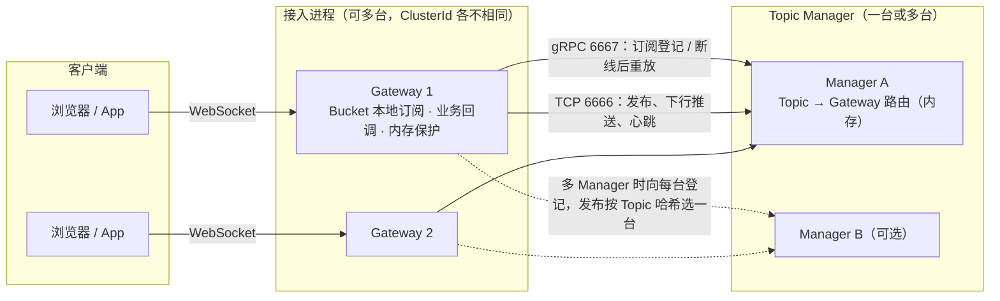

<p align="center"><a href="http://chat.ojbk.io" target="_blank" rel="noopener noreferrer"></a></p>

<p align="center">
  <a href="https://github.com/OSMeteor/beacontower/archive/master.zip"></a>
  <a href="https://goreportcard.com/report/github.com/OSMeteor/firetower"></a>
  
  
  
  
</p>
<h1 align="center">Firetower</h2>
firetower是一个用golang开发的分布式推送(IM)服务  

完全基于websocket封装，围绕topic进行sub/pub    
自身实现订阅管理服务，无需依赖redis  
聊天室demo体验地址（原项目提供）: http://chat.ojbk.io  
### 关于本仓库
本仓库最初 fork 自 [holdno/firetower](https://github.com/holdno/firetower)，感谢原作者。现在它是一条独立维护的分支：  
- 代码已经和上游分开演进，不再同步上游的改动，也不保证和上游的版本互相兼容。  
- 模块路径是 `github.com/OSMeteor/firetower`，问题和改动请提到本仓库。  
- 许可证沿用 MIT，保留原作者的版权声明，见 [LICENSE](LICENSE)。  
- 文中的 logo、架构图和聊天室 demo 地址来自原项目，不由本仓库维护。  
### 可用版本
go get github.com/OSMeteor/firetower@v0.6.0  

依赖要求：`google.golang.org/grpc` v1.25 及以上。项目的 go.mod 里如果有把 grpc `replace` 到更老版本（例如 v1.20.1）的行，要先升级或去掉，否则会报找不到 `google.golang.org/grpc/backoff`。  

各版本的改动见 [Change_Log.md](Change_Log.md)。  
### 构成

基本服务由两点构成  
- topic管理服务  
> 详见示例 example/topic_service  

该服务主要作为集群环境下唯一的topic管理节点  
firetower一定要依赖这个管理节点才能正常工作  
大型项目可以将该服务单独部署在一台独立的服务器上，小项目可以同连接层服务一起部署在一台机器上  
- 连接层服务(websocket服务)  
> 详见示例 example/websocket_service  

websocket服务是用户基于firetower自定义开发的业务逻辑  
可以通过firetower提供的回调方法来实现自己的业务逻辑  
（web client 在 example/web 下)  
### 架构图  
v0.6.0 的整体结构（多 Gateway、多 Manager 都是可选的，只配一台 Manager 时和以前一样）：



单台 Gateway 内部的消息路径见原项目的图（不含多 Manager、分片和内存保护）：  
  
### 接入姿势  
``` golang 
package main

import (
    "fmt"
    "github.com/gorilla/websocket"
    "github.com/OSMeteor/firetower/service/gateway"
    "github.com/holdno/snowFlakeByGo" // 这是一个分布式全局唯一id生成器
    "net/http"
    "strconv"
)

var upgrader = websocket.Upgrader{
    CheckOrigin: func(r *http.Request) bool {
        return true
    },
} 

var GlobalIdWorker *snowFlakeByGo.Worker

func main() {
    GlobalIdWorker, _ = snowFlakeByGo.NewWorker(1)
    // 如果是集群环境  一定一定要给每个服务设置唯一的id
    // 取值范围 1-1024
    gateway.ClusterId = 1
    // 读取工作目录下的 fireTower.toml，建立到 topic 管理服务的连接。必须先调用
    gateway.Init()
    http.HandleFunc("/ws", Websocket)
    fmt.Println("websocket service start: 0.0.0.0:9999")
    http.ListenAndServe("0.0.0.0:9999", nil)
}

func Websocket(w http.ResponseWriter, r *http.Request) {
    // 做用户身份验证
    ...
    // 验证成功才升级连接
    ws, err := upgrader.Upgrade(w, r, nil)
    if err != nil {
        return
    }
    // 生成一个全局唯一的clientid 正常业务下这个clientid应该由前端传入
    id := GlobalIdWorker.GetId()
    tower := gateway.BuildTower(ws, strconv.FormatInt(id, 10)) // 生成一个烽火台
    if tower == nil { // 还没连上 topic 管理服务、连接数已到上限、内存保护拒绝新连接或正在下线
        ws.Close()
        return
    }
    tower.Run()
}
```
### 目前支持的回调方法
- ReadHandler 收到客户端发送的消息时触发
``` golang
tower := gateway.BuildTower(ws, strconv.FormatInt(id, 10)) // 创建beacontower实例
tower.SetReadHandler(func(fire *gateway.FireInfo) bool { // 绑定ReadHandler回调方法
    // fire.Message.Data 为客户端传来的信息
    // fire.Message.Topic 为消息传递的topic
    // 用户可在此做发送验证
    // 判断发送方是否有权限向到达方发送内容
    // 通过 Publish 方法将内容推送到所有订阅 fire.Message.Topic 的连接
    tower.Publish(fire)
    return true
})
```

- ReadTimeoutHandler 客户端websocket请求超时处理(生产速度高于消费速度)
``` golang 
tower.SetReadTimeoutHandler(func(fire *gateway.FireInfo) {
    fmt.Println("read timeout:", fire.Message.Type, fire.Message.Topic, fire.Message.Data)
})
```

- BeforeSubscribeHandler 客户端订阅某些topic时触发(这个时候topic还没有订阅，是before subscribe)
``` golang
tower.SetBeforeSubscribeHandler(func(context *gateway.FireLife, topic []string) ([]string, bool) {
    // 这里用来判断当前用户是否允许订阅该topic
    // 也可以在这里修改 topic 列表实现热点分桶
    return topic, true
})
```

- SubscribeHandler 客户端完成某些topic的订阅时触发(topic已经被topicService收录并管理)
``` golang
tower.SetSubscribeHandler(func(context *gateway.FireLife, topic []string) bool {
    // 我们给出的聊天室示例是需要用到这个回调方法
    // 当某个聊天室(topic)有新的订阅者，则需要通知其他已经在聊天室内的成员当前在线人数+1
    for _, v := range topic {
        num := tower.GetConnectNum(v)
        // 继承订阅消息的context
        var pushmsg = gateway.NewFireInfo(tower, context)
        pushmsg.Message.Topic = v
        pushmsg.Message.Data = []byte(fmt.Sprintf("{\"type\":\"onSubscribe\",\"data\":%d}", num))
        tower.Publish(pushmsg)
    }
    return true
})
```

- UnSubscribeHandler 客户端取消订阅某些topic完成时触发 (这个回调方法没有设置before方法，目前没有想到什么场景会使用到before unsubscribe，如果有请issue联系)
``` golang
tower.SetUnSubscribeHandler(func(context *gateway.FireLife, topic []string) bool {
    for _, v := range topic {
        num := tower.GetConnectNum(v)
        // 继承订阅消息的context
        var pushmsg = gateway.NewFireInfo(tower, context)
        pushmsg.Message.Topic = v
        pushmsg.Message.Data = []byte(fmt.Sprintf("{\"type\":\"onUnsubscribe\",\"data\":%d}", num))
        tower.Publish(pushmsg)
    }
    return true
})
```
注意：当客户端断开websocket连接时firetower会将其在线时订阅的所有topic进行退订 会触发UnSubscirbeHandler  

## 系统架构与扩容阶段

Firetower 采用 **Gateway (接入层)** + **TopicManager (逻辑控制层)**。在线连接在 Gateway，Topic 到 Gateway 的路由在 Manager 内存里，不依赖 Redis、Kafka 等外部组件。

**当前状态：v0.6.0 的并发修复、故障恢复、多 Manager、Topic 分片和内存保护已在 Linux 与 Windows 上通过竞态检测、单元测试、模糊测试和真实进程的阶段 2/3/4 测试（单机）。** 测试项和结果见 [docs/release-test-plan.md](docs/release-test-plan.md)。容量数字以压测结果为准，不作为 SLA。

### 1. 核心组件
*   **Gateway (Websocket Service)**:
    *   **职责**: 维护 WebSocket 长连接，处理协议封包/解包，把消息写给本机的订阅者。
    *   **特性**: 订阅关系按 Gateway 登记到 Manager。发送队列满时丢弃该连接上的这一条，不阻塞其他连接。投递语义是至多一次。
*   **TopicManager (Topic Service)**:
    *   **职责**: 管理 Topic -> Gateway 的映射，接收发布并转发给持有该 Topic 订阅者的 Gateway。
    *   **特性**: 状态全在内存里，重启后由各 Gateway 重放订阅来重建。

### 2. 接入方式不变
客户端协议（`topic` / `data` / `type` 的 JSON 文本帧）和上文的回调接口保持不变。新增的能力除内存保护外都是默认关闭或对接入方不可见的。

接入方唯一要注意的一点：内存保护默认开启，内存紧张时 `BuildTower` 会返回 `nil`（和连接数到上限时一样），调用方必须判断并 `ws.Close()`，见上文示例。

### 3. 代码里已有的能力
*   **故障恢复**: Gateway 到 Manager 的 TCP 断开后带抖动重连，重连后自动重放本机订阅，客户端不用重新订阅。登记带绝对人数和版本号，重放是幂等的。
*   **故障检测**: Gateway 读 Manager 有读超时，Manager 写 Gateway 有写超时，一台慢的 Gateway 不拖住其他。
*   **保护**: 关键协程、用户回调和日志回调都有 recover，出问题只关闭那一条连接；每帧和每连接的 Topic 数、总连接数有上限。握手、对账用的保留 Topic 不对客户端开放。
*   **内存保护（默认开启）**: Gateway 和 Manager 每 100ms 读一次存活堆，不强制 GC。上限优先取配置 `[memory] limitMB`，不配置时自动取 GOMEMLIMIT、cgroup 和物理内存中最小的一个，`disable = true` 关闭。70% 拒绝新连接，85% 起按积压、不活跃、连接时长清理连接，持续有心跳或消息的连接不会被清理。详见 [docs/scale-plan.md](docs/scale-plan.md) 的「内存保护」。
*   **订阅登记**: 登记 RPC 超时按 500ms、1s、2s 重试。Manager 慢或暂时不可用时订阅先留在本机，由后台重放补登记，不会丢。
*   **多 Manager**: 配置里用 `[[manager]]` 列出多台，订阅向每一台登记，发布按 Topic 做最高随机权重哈希选一台。只配一台时行为和以前相同。
*   **房间分片**: `[[group]]` 或 `SetTopicShards` 把大房间拆成多片，客户端和业务后端仍只用房间名。默认关闭。
*   **默认关闭的可选项**: 缺失提示帧、被动订阅、热点 Topic 独立队列、房间分片、订阅失败回调。

### 4. 文档
*   [docs/architecture.md](docs/architecture.md)、[docs/network-communication.md](docs/network-communication.md): 组件和消息流转。
*   [docs/scale-plan.md](docs/scale-plan.md): 各阶段的做法、在线人数估算、大房间、部署与配置。「当前代码与改法」一节里标「v0.6.0 已实现」的条目已包含在 v0.6.0 中。
*   [docs/deploy.md](docs/deploy.md): 给运维的部署手册：各场景的机器规划、配置模板、增减 Manager 的步骤、上线检查清单、告警和故障处理。
*   [docs/release-test-plan.md](docs/release-test-plan.md): 上线前要跑的测试和 v0.6.0 的测试结果（含 `cmd/stagecheck` 真实进程测试）。
*   [docs/pain-points.md](docs/pain-points.md): 其他公司公开分享的事故和架构材料。
 
## TODO
- 运行时web看板  
- 提供推送相关http及grpc接口

## License  
[MIT](https://opensource.org/licenses/MIT)

