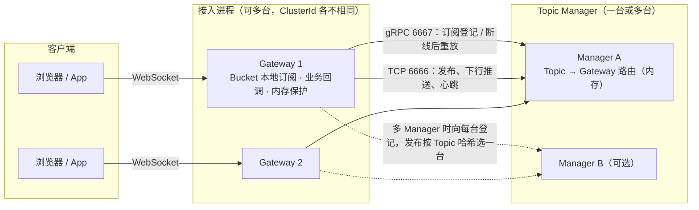

# Firetower 架构概览

本文描述 **v0.6.0** 的代码。扩容方案、阶段和各项改动的细节见 [scale-plan.md](scale-plan.md)。评估方案时以该文为准。

## 核心组件

### WebSocket 网关（Gateway）
- **连接生命周期管理**：`service/gateway/tower.go` 中的 `FireTower` 对象封装单条客户端连接的状态、读写队列以及订阅列表，并在 `Run` 启动时并行执行读取、处理与发送循环。Gateway 在关闭连接时会自动退订全部 Topic 并回收资源。
- **本地订阅索引**：`service/gateway/bucket.go` 中的 `TowerManager` 将同一实例的连接划分到多个 `Bucket`，每个桶内部维护 `topic -> connection` 的映射。`dispatch` 会把每条消息送进全部分 Bucket。Bucket 在启动时按配置建好并常驻。
- **Topic 管理客户端**：启动阶段通过 `Init` 加载配置、构建 Bucket，并建立到 Manager 的 gRPC 与 TCP 客户端，用于提交订阅关系、查询 Topic 状态和写入推送数据通道。
- **回调扩展点**：Gateway 暴露 `SetReadHandler`、`SetSubscribeHandler` 等回调，允许业务侧在订阅、取消订阅或消息到达时插入自定义逻辑。

### Topic 管理服务（Manager）
- **订阅关系中心**：`service/manager/manager.go` 使用 gRPC 暴露 `SubscribeTopic`、`UnSubscribeTopic` 和 `CheckTopicExist` 等接口，将每个 Topic 与发起订阅的 Gateway 地址建立映射，并记录订阅计数。
- **推送总线**：Gateway 调用 `Publish` 后，帧写在已经建立的 TCP（`6666`）上。Manager 的 `connectBucket.sendLoop` 按 Topic 找到 Gateway 地址，再从这些长连接写回去。gRPC `Publish` 是另一条入口。订阅和退订走 `6667`。
- **运行时观测**：内置 HTTP Dashboard，可按 Topic 返回订阅量等运行时指标，便于监控与排障。
- **对外端口**：默认监听两个端口——`6666` 用于 Gateway 通过 TCP 建立长连接执行推送与心跳，`6667` 暴露 gRPC 服务给业务或 Gateway 发起订阅、退订与发布请求；两者分别在 `config/fireTower.toml` 的 `topicServiceAddr` 和 `[grpc].address` 中配置。
- **水平扩展**：不引入 Redis 或 Kafka。Gateway 可以多台。Manager 也可以多台（`[[manager]]`）：每台都有全量路由，Gateway 向每台登记，发布按 Topic 做最高随机权重哈希只写一台，一台故障时落到下一台。大房间可以用 `[[group]]` 分片，各片落到不同 Manager。可靠消息放在路由外面。见 [scale-plan.md](scale-plan.md)。
- **故障恢复**：路由以 Gateway 本机的订阅统计为准。Gateway 与 Manager 的 TCP 断开后带抖动重连，连上先握手（键为 `ClusterId-启动随机数-连接代数`），再分批（每批 256 个 Topic）重放本机订阅；登记带绝对人数和版本号，重复登记不会多算。每 3 分钟对账一次，这一轮没出现的 Topic 从该 Gateway 删掉。客户端不用重新订阅。

### Socket 协议层
Manager 与 Gateway 之间的 TCP 帧以 `FireHeader` 开头，后面是长度、指令、消息 ID、来源、Topic 和正文。组包与拆包在 `socket/protocol.go` 的 `Enpack`、`Depack`。这个消息 ID 是传输 id。

## 进程间协作流程
1. **Gateway 启动**：`service/gateway/tower.go` 的 `Init` 读取配置、创建 Bucket，并由 `manager_client.go` 建立到 Manager 的 gRPC 与 TCP 连接。
2. **连接接入**：业务代码通过 `BuildTower` 包装 WebSocket 连接；`Run` 方法启动后即进入读写循环，并可在连接回调中完成鉴权或初始化。
3. **订阅登记**：客户端发送订阅消息时，Gateway 先在本地 Bucket 建立 Topic -> Connection 映射，再通过 gRPC 将订阅同步到 Manager，确保后续推送可路由到该 Gateway。
4. **消息推送**：业务通过 `Publish` 将消息写入 Manager 的 TCP 通道；Manager 解包后，按 Topic 写回已登记的 Gateway。Gateway 的 `dispatch` 把这条消息送进每一个 Bucket，再由持有该 Topic 的连接写出。

## 部署拓扑
- **单节点调试**：可将 Manager 与 Gateway 同机部署，适用于开发或低并发场景。
- **多 Gateway**：多开进程指向同一组 Manager，每个进程设置不同的 `ClusterId`。
- **多 Manager / 房间分片**：可选，配置见 [scale-plan.md](scale-plan.md) 的「部署与配置」。只配一台 Manager、不配分片时行为和单机一样。
- **外部依赖**：Firetower 不依赖 Redis 等外部队列，消息路由全部由自建的 Manager 服务负责。

## 进程保护
- **不崩**：读写循环、Bucket 消费者、Manager 连接处理、用户回调（OnConnect、读、订阅、退订、离线）和日志回调里的 panic 都会被接住，只关闭出问题的那条连接。
- **内存保护**：Gateway 和 Manager 默认开启，每 100ms 读一次存活堆，不强制 GC、不暂停业务。上限优先取配置 `[memory] limitMB`，否则自动取 GOMEMLIMIT、cgroup、物理内存中最小的一个。Gateway 在 70% 拒绝新连接，85% 起按积压、不活跃、连接时长挑选连接关闭，持续有心跳或消息的连接不会被挑中；Manager 在压力下丢弃发往慢 Gateway 的积压帧。细节见 [scale-plan.md](scale-plan.md) 的「内存保护」。

## 参考图示
本文开头的图是 v0.6.0 的整体结构。README 里的 `firetower_process.png` 来自原项目，只画了一台 Gateway 的内部路径：客户端、Gateway、一个 Manager、`centralChan` 和 Bucket，不包含多 Manager、房间分片和内存保护。
