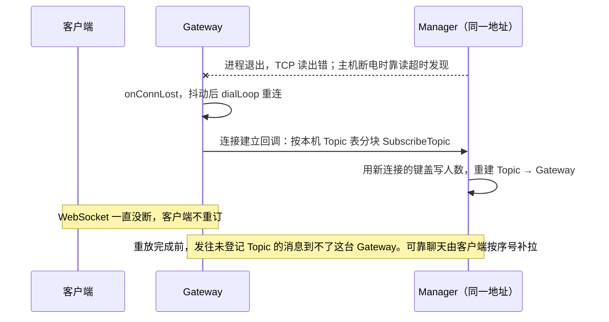

# Firetower 扩容方案

**状态：待实施的方案，不是已完成功能。** 评估以本文为准。`docs/architecture.md` 和 `docs/network-communication.md` 只描述当前代码。`Whitepaper.md` 与旧版 `Scalability_Guide.md` 里的人数和中间件路线不参与评估。外部公司的事故和架构材料单独放在 [pain-points.md](pain-points.md)。

本文的每一条改法都对着现有函数写。核对的代码是 `service/gateway/tower.go`、`service/gateway/bucket.go`、`service/gateway/manager_client.go`、`service/manager/manager.go`、`socket/socket.go`、`socket/protocol.go`、`grpc/manager/topicmanage.proto`，以及三处 `audit_*_test.go`。核对的基线是提交 `682da3f`。工作区里未提交的修改（查看时间 2026-11-10 13:33）已经标在表里。标了「工作区已改」的行，提交并跑过对应用例后可以删掉。

Firetower 是实时分发层：Gateway 持有 WebSocket，Manager 只保存 `Topic → Gateway 地址 + 计数`。一条消息走 Gateway 与 Manager 之间已经建立的 TCP（`6666`）。订阅和退订走 gRPC（`6667`）。不把 Redis 或 Kafka 放进扇出热路径。

在线人数是压测目标，不是 SLA；各阶段的数字和推算过程见「各阶段的在线人数」。容量高了打 `WARN`，日志里写明该扩哪一层。加大 `chanLens` 不是扩容。

## 不能变的部分

所有阶段的改动都不能改变主体功能、流程和接入方式。下面四个面在改动前后必须一致：

| 对外的面 | 现在的样子 |
| :--- | :--- |
| 客户端协议 | WebSocket 文本帧，JSON 里有 `topic`、`data`、`type`。`type` 为 `subscribe`、`unSubscribe` 时订阅和退订，`topic` 用逗号分隔多个；其余类型交给 `readHandler`（`readDispose`）。下行是发布方的 `data` 原样写出（`sendLoop`），外加 WebSocket Ping 和踢人时的 `{}` |
| 接入进程用的 Go 接口 | `gateway.Init`、`ClusterId`、`DefaultConfigPath`、`BuildTower`、`Run`、`Publish`、`ToSelf`、`Send`、`Close`、`GetConnectNum`、`CheckTopicExist`、全部 `Set…Handler`、`GetTopicManage`、`GetTopicManageGrpc`；Manager 侧的 `StartGrpcService`、`StartSocketService`、`HttpDashboard` |
| 业务服务端调用的 gRPC | `TopicService` 的五个方法和现有字段 |
| 配置键 | `fireTower.toml`、`topicmanage.toml` 里现有键的名字和含义 |

三条规则：

- 新增的对外行为一律默认关闭，接入进程显式打开才生效。包括缺失提示帧、订阅失败通知、消息类别、被动订阅、Gateway 排空。
- 导出的函数和 gRPC 消息只加不改。Gateway 与 Manager 之间的内部协议可以加字段和帧类型，但旧版本的对端仍要能工作，见「各阶段之间的兼容」。
- 配置取值由部署方决定。文档只指出哪一份副本的值有问题，不替部署方改。

方案里碰到这条线的地方：

| 改动 | 接入方能不能看到 | 处理 |
| :--- | :--- | :--- |
| `ToSelf` 改为入队（工作区已改） | 签名不变。以前是同步写、返回写错误；现在是入队，队列满时返回错误，实际写出稍后发生 | 接受。这是消除并发写所必需的，写进发布说明 |
| 心跳只发 WebSocket Ping | 客户端不收到文本 `heartbeat`。`sendOut` 满只丢业务消息，不因此断开 | 保持。不把心跳塞进 `sendOut` |
| 登记带绝对人数 | 看不到。`GetConnectNum` 的数值和现在一致 | — |
| 订阅上报改成 0↔1 | 能。`GetConnectNum` 会滞后一个同步周期，示例在订阅回调里立刻读它来广播人数 | 和本节冲突，默认不做。后果见「各阶段的在线人数」：阶段 3 只提高发布吞吐，不提高在线上限 |
| 订阅失败通知、缺失提示、消息类别、被动订阅 | 能，都是新的帧或新的行为 | 默认关闭 |
| 握手帧、proto 新字段、重放、连接池、每台一条写队列 | 看不到 | — |
| 阶段 3 各台 Manager 的人数暂时不同 | 能 | 约定 `GetConnectNum` 读哪一台，见阶段 3 |
| 空指针改为返回错误 | 合法调用不变。空消息、未初始化的客户端以前会 panic | 接受。进程不能因此退出 |

## 边界

Firetower 框架只做至多一次的路由。可靠聊天需要的消息身份、序号、存储、确认和补拉是另一层，不作为进入阶段 2 的前提。

这条边界来自代码，不是取舍：

- `FireTower.Publish` 把 `fire.Context.id`（雪花 id）放进帧头，正文 `fire.Message.Data` 原样透传。`sendLoop` 写给客户端的只有 `message.Data`，帧头里的 id、来源和 Topic 都不下发。业务 `MessageID` 和序号只能放在正文里，框架不需要为它们改一行。
- 同一个 Topic 可以从任意一台 Gateway 发布，Manager 的状态全在内存里，重启即空。框架里没有一个位置能发出不回退的递增序号。序号只能由持久化的消息日志发。

所以顺序是：业务服务先写消息日志，拿到 `MessageID` 和序号，再调用 `Publish`。客户端按 `MessageID` 去重，按序号发现缺口并向日志服务补拉。消息日志是一个存储组件，归业务侧维护；它在扇出路径旁边，不在路径上。

框架为这一层只提供两样东西，都在 1B：

- **消息类别。** 帧头的第一个字段是自由字符串，Manager 的 `sendLoop` 原样转发 `message.Type`，Bucket 的 `consumer` 按它分支。增加一个类别（例如可丢弃的状态事件）是新增一个取值，不改帧格式。
- **缺失提示。** `FireTower.Send` 在 `sendOut` 满时丢弃。丢弃的若不是状态事件，就在这条连接上给该 Topic 置一个标志；`sendLoop` 下一次能写时发一帧提示并清掉标志。用标志而不是入队，提示本身不会被丢。提示帧的格式是和客户端的新约定，目前框架自己发给客户端的只有 WebSocket Ping 和踢人时的 `{}`。它默认关闭，接入进程打开后才发，现有客户端不会收到没见过的帧。

手机进后台后 WebSocket 会断。系统推送和用户回来后的补拉都在业务侧。权限和成员列表不进 Manager，Gateway 在订阅和发布回调里去问。

## 当前代码与改法

「验收」一列是仓库里已有的用例名，省略了 `TestAudit_` 前缀。标 ✗ 的是读代码时期望失败的行为，标 ✓ 的期望通过。本机已经能跑 `go test`，实测以「本地分阶段测试」为准。

### 1A 缺陷修复

单机部署就会遇到，和扩容无关。

| 位置 | 现在的行为 | 改法 | 验收 |
| :--- | :--- | :--- | :--- |
| `TowerManager.dispatch`、`socket.GetSendMessage` | 同一个 `*SendMessage` 被送进每个 Bucket，随后立刻 `Recycling()` 放回池子。慢连接队列里还没写出的消息，会被池子复用成别的 Topic 的内容 | **工作区已改，未提交。** `dispatch` 经 `cloneSendMessage` 给每个 Bucket 一份副本，正文和 `Context` 都单独拷贝。`Recycling` 不再入池，`GetSendMessage` 直接新建。`sendLoop` 用局部变量决定 WebSocket 帧类型，不写共享对象的 `MessageType` | ✓ `FT03_QueuedMessageKeepsPayload`、✓ `CO03_PoolGetClearsPayload`、✓ `CO06_SendLoopLeavesMessageType` |
| `FireTower.ToSelf` | 直接调用 `ws.WriteMessage`，和 `sendLoop` 并发写同一条 WebSocket。`Bucket.unSubscribeByUserId` 也从消费者协程里调用它 | **工作区已改，未提交。** `ToSelf` 改为拷贝正文后经 `Send` 入队。`FT08` 用例同时改成了检查队列长度 | ✓ `FT08_ToSelfIsQueued`、✓ `CO02_SingleWriter`（2026-11-10 本机） |
| `connectBucket.sendLoop`（Manager） | 写某一台 Gateway 失败后关闭对方并 `return`。退出的是**收到这帧的那条连接**的发送循环，之后这台 Gateway 发来的帧先堆满 `packetChan`（1024），再被 `Depack` 丢弃 | **工作区已改，未提交。** 写失败只 `close` 那一台，然后 `continue`。取目标走 `snapshotTargets`，读锁用 `defer` 释放 | ✓ `NW07_FailedWriteDoesNotStopPublisher` |
| `topicGrpcService.Publish` 与 `connectBucket.sendLoop` | 发布有两条入口。业务 `Publish` 走 TCP，`sendLoop` 里串行 `conn.Write`。gRPC `Publish` 另写一遍。TCP 那条仍会因一台慢连接堵住这台 Gateway 发出的所有 Topic | **工作区已改，未提交。** 两条入口都经目标连接的 `outbox`。锁内只拷贝目标，锁外写 | ✓ `FT10_PublishWriteDoesNotBlockSubscribe`、✓ `NW06_SlowGatewayDoesNotBlockOthers`、✓ `FullOutboxDoesNotBlockPublisher` |
| `connectBucket.sendLoop`、`delRelation`、`topicWebHandler` | 遍历 `topicRelevance` 里的链表时不持锁，而 `SubscribeTopic` 在 `t.mu` 下修改同一条链表 | **工作区已改，未提交。** `sendLoop`、`delRelation`、`getConnectNum`、`topicWebHandler` 都改为在 `topicMu` 下访问链表 | 普通 `go test` 下 `CO04_SubscribeRacesForward` 通过（2026-11-10）。`-race` 本机没有 gcc，还没跑 |
| Manager 对 Gateway 的写出 | 每个发布方连接一个 `sendLoop`，串行 `conn.Write`，没有写超时。对端主机断电时写不会立刻失败，内核缓冲写满后这个 `sendLoop` 卡住，这台 Gateway 发布的所有 Topic 都停 | **工作区已改，未提交。** 每条接入的 Gateway 一条 4096 长的 `outbox` 和 `writeLoop`，写超时 5 秒。队列满就丢掉这一帧并计数，写失败只关闭这一台。没有 `outbox` 的连接仍直接写，现有用例不用改 | ✓ `FullOutboxDoesNotBlockPublisher`、✓ `FullOutboxIsCounted` |
| `connectBucket.relation`、`close` | `ConnIndexTable` 在连接关闭后不删除。同一个地址再次出现时 `relation` 因为键已存在而不替换，新连接不会被索引 | **工作区已改，未提交。** `relation` 用 `Swap` 覆盖，并关掉被换下的旧连接。`close` 用 `CompareAndDelete`，只在表里的值仍是自己时删除 | ✓ `CO05_ReplacedConnKeepsIndex` |
| `managerIP` | 先读 `topicManage.Conn` 再调 `LocalAddr()`，重连协程会在这两步之间把连接换掉 | **工作区已改，未提交。** 改为 `topicManage.CurrentAddr()`，空地址当错误 | ✓ `ManagerIPNilConn` |
| 空调用 | `Publish`、`CheckTopicExist`、`GetConnectNum`、`TcpClient.Publish`、`relation` 遇到空指针会 panic。`relation` 跑在 Accept 循环里，一 panic 就不再接入新连接 | **工作区已改，未提交。** 空值返回错误或直接返回。一条坏连接只关掉自己，Accept 循环继续 | ✓ `TestStage0`（2026-11-10 本机） |
| `socket.Depack` | 目标队列满时返回 `nil` 和错误，调用方把它当作剩余缓冲，这次读到的后续帧和半包一起丢掉 | **工作区已改，未提交。** 满队列只丢掉当前这一帧并计入 `DroppedFrames`，后面的帧和半包照常返回。非法长度仍拒绝整段，避免把坏长度当成半包一直攒 | ✓ `FullQueueKeepsTheFollowingBytes`、✓ `PR01_DepackDoesNotBlockWhenConsumerIsGone` |
| `TcpClient.readLoopConn`（Gateway 侧） | 读 Manager 的 TCP 没有读超时。Manager 每 10 秒发的心跳帧在 `Read` 里被直接跳过，不用来计时。Manager 主机断电或网络中断时，Gateway 发现不了 | **工作区已改，未提交。** 在 `conn.Read` 上设 30 秒超时（3 个 10 秒心跳）。任何字节，包括心跳，都重新计时。超时走 `onConnLost`。不用 `fireTower.toml` 的 `heartbeat` | ✓ `ReadTimeoutReplacesSilentManager` |
| `TcpClient.dialLoop`、`waitRetry` | 断线后固定等 1 秒重连，失败后也是固定 1 秒，没有抖动。`Change_Log.md` 写的指数退避只在 `manager_client.go` 的首次连接里 | **工作区已改，未提交。** 从 200ms 起倍增，封顶 30 秒，每次在一半到全额之间随机。`Shutdown` 在等待期间返回 | ✓ `RetryDelayIsJitteredAndCapped`、✓ `TC02_ShutdownStopsReconnect` |
| `manager_client.go` 的 `OnPush` | `TM.centralChan <- sendMessage` 是阻塞发送。`centralChan` 满时，读 Manager 的循环停住。加上面的读超时后，这会被当成 Manager 断电，触发重连和全量重放 | **工作区已改，未提交。** 写不进就丢这一帧，不堵住读循环 | 随读超时一起用 |
| 重连之后 | `swapConnLocked` 只换连接。Manager 已经按旧地址 `delRelation`，Gateway 不会把本机订阅再登记一次。WebSocket 没断，客户端不知道要重订，这台机器上的用户静默收不到消息 | **工作区已改，未提交。** `TcpClient.SetOnConnect` 在连接建立后回调。Gateway 用本机 `Topic → 人数` 表分块调用 `SubscribeTopic`。客户端不用重订 | ✓ `NW05_ReconnectReplaysSubscriptions` |
| `SubscribeTopic`、`bindTopic` | 对同一地址每次 `num++`。超时重试或重放会让计数只增不减 | **工作区已改，未提交。** 请求带 `Count` 和 `Version`，和 `Topic` 一一对应。版本更新才盖写，更旧的丢掉，人数为 0 即删除。字段缺失时仍是 `num++`，旧 Gateway 不用改 | ✓ `AbsoluteCountOverwritesAndIgnoresStale`；✓ `FT09_SubscribeHasDeadline` 保留 |
| `readDispose` 的 `subscribe` 分支 | `bindTopic` 失败只调用 `fire.Error` 写日志，不通知客户端 | **工作区已改，未提交。** `SetSubscribeFailHandler` 可选。不设置时仍只记日志，不回新帧，也不关连接 | ✓ `SubscribeFailHandler` |
| `GetConnectNum`、`CheckTopicExist`（Gateway 侧） | 用 `context.Background()`，没有超时。示例的 `subscribeHandler` 在 `readDispose` 里调用 `GetConnectNum`，Manager 不响应时这条连接的读处理停住 | **工作区已改，未提交。** 这两次 RPC 使用和订阅一样的 500ms 超时 | ✓ `ManagerRPCDoesNotHang` |
| 热路径日志 | `LogLevel` 默认 `INFO`。`dispatch` 的 `message.Info("Sended")`、`readDispose` 的 `fire.Info("Extinguished")`、Manager 的 `new message` 和 `topic manager sended` 每条消息都同步打印全文。`Send` 每丢一条打一次 `WARN`，`dispatch` 每丢一条 `Printf` 一次。慢连接多的时候日志本身先成为瓶颈 | **工作区已改，未提交。** 这几处正文每 1024 条打一条，其余只计数。`Send` 丢弃和 Bucket 丢弃每秒最多一条日志 | ✓ `HotLogIsSampled` |
| `config/fireTower.toml` | 这份副本里 `heartbeat = 600`，读超时是 2 倍，死连接要等约 1200 秒。仓库根和示例目录的副本是 30，代码缺省也是 30 | 三处副本收敛成一份，取几十秒，具体值由故障注入确定。见「部署与配置」 | ✓ `NW02_SilentClientIsClosed` |
| 接入进程 | 示例里升级前的身份校验是一行注释，`CheckOrigin` 恒为 `true` | 没有鉴权回调的进程不能进生产。这是接入进程的事，框架不改 | — |

### 1B 单机容量

| 位置 | 现在的行为 | 改法 |
| :--- | :--- | :--- |
| `TowerManager.dispatch` | 每条消息送进全部分 Bucket。所有 Topic 共用 `centralChan` 和 `BuffChan`，热点把队列填满后，别的 Topic 在 `default` 分支被丢掉 | **工作区已改，未提交。** 只送给当前持有该 Topic 的 Bucket。`bucket.HotTopicMin` 大于 0 时，本桶订阅者达到这个数的 Topic 走自己的队列，默认 0 关闭。✓ `OnlyBucketsHoldingTheTopicReceive`、✓ `HotTopicSkipsTheSharedQueue` |
| `Bucket.consumer` | 每个 Bucket 有 `ConsumerNum` 个消费者并发 `push`（`config/` 副本里是 32，另两处是 1）。大于 1 时同一条连接上的两条消息先后不定 | 框架不承诺顺序，可靠聊天靠序号重排。热点 Topic 在自己的队列里单独投递，不占共用消费者 |
| `FireTower.Send` | `sendOut` 满即丢，没有类别，也没有提示 | **工作区已改，未提交。** 状态事件的类型是 `state`。缺失提示默认关闭，接入进程调用 `EnableGapHints` 后，丢弃业务消息会在下一次能写时发一帧 `{"type":"gap","topic":...}`。✓ `GapHintIsOffUntilEnabled` |
| `Bucket.push` | 对该 Topic 的每条本机连接都 `Send`，没有主动 / 被动之分 | **工作区已改，未提交。** `SetPassive` 默认关闭。打开后该连接不收 `state`，业务消息照旧。✓ `PassiveSkipsStateOnly` |
| `chanLens` | 当前 1000，`readIn` 和 `sendOut` 共用 | 压测后缩小。它只决定丢弃前能攒多少，不是容量 |
| `bindTopic` | 每个客户端每次订阅都发一次 gRPC | 先不动。修完锁之后单次登记很轻。压测显示订阅 RPC 成为瓶颈时，再改成 0↔1 立即上报、人数定时同步；代价是 `GetConnectNum` 会滞后一个同步周期，示例里的在线人数广播依赖它 |

### 阶段 2 多 Gateway

| 位置 | 现在的行为 | 改法 |
| :--- | :--- | :--- |
| 路由键 | 登记用 Gateway 看到的 `LocalAddr()`，Manager 索引用自己看到的 `RemoteAddr()`。中间有地址转换时两边字符串不一致，路由表里有地址却找不到连接 | **工作区已改，未提交。** 连上后先发保留 Topic `_firetower_handshake`，键是 `ClusterId-启动随机数-连接代数`。Manager 确认后改用这个键，gRPC 的 `Ip` 也填它。没收到握手的连接仍用 `RemoteAddr()`。同一 `ClusterId` 出现两个启动随机数时打 WARN。确认超时则 Gateway 退回本地地址 | ✓ `HandshakeReplacesRemoteAddr` |
| Manager 进程 | 路由全在内存里，退出即空 | 保持单地址。Manager 由进程守护拉起，或者由运维切换 VIP / DNS；`dialLoop` 每次重连都会重新解析地址。恢复靠 1A 的重放。同一时刻只有一个地址，不存在「谁是主」的判定 |
| 重放 | 1A 之后每台 Gateway 重连即重放，并每 3 分钟把整张表再盖写一次。一轮带开始和结束标记，这一轮没出现的 Topic 从该 Gateway 删掉。同一时刻只跑一轮 | **工作区已改，未提交。** 登记同时最多 8 个，多出来的排队，每秒最多一条 WARN。✓ `ReconcileDropsTopicsMissingFromTheRound`、✓ `ReplayIsOneAtATime`、✓ `RegisterWaitsWhenFull` |
| Gateway 退出 | 没有排空。进程被杀时 WebSocket 直接断开 | **工作区已改，未提交。** `Drain` 先拒绝新的 `BuildTower`，再按批 `Close`。不调用时接入流程不变 | ✓ `DrainClosesAndRejects` |

### 阶段 3 多 Manager

| 位置 | 现在的行为 | 改法 |
| :--- | :--- | :--- |
| `topicManage`、`topicManageGrpc` | 进程内只有一对全局变量，`GetTopicManage()` 和 `GetTopicManageGrpc()` 还是导出的 | **工作区已改，未提交。** 按地址索引的连接池。旧的 `topicServiceAddr` 和 `grpc.address` 仍是只有一台的列表。`[[manager]]` 可分别标 `register` 和 `publish`。两个导出函数签名不变，返回池里的第一台 | ✓ `OldConfigIsOneManagerAndListCanSplitRoles` |
| 订阅 | 只登记到唯一的 Manager | **工作区已改，未提交。** 登记集合里当前连得上的每一台都盖写成功，才在本机 Bucket 留下这个连接。一台失败就整次失败，不留本地订阅 | ✓ `RegisterIsAllOrNothing` |
| 发布 | 写进唯一的 TCP | **工作区已改，未提交。** 在发布集合里用最高随机权重选一台，不用取模。只有一台时永远是它。`wait` 只在启动预热时发出，登记进行中仍是 `ready`。有别的 `ready` Manager 时不选 `wait`；一台都不是 `ready` 时退回任意一台连得上的。换一台时 `ManagerFlaps` 加一 | ✓ `OneManagerIsAlwaysPicked`、✓ `HashStaysUntilThatManagerLeaves`、✓ `RegisterOnlyManagerDoesNotReceivePublish`、✓ `HeartbeatWaitIsNotPublishable`、✓ `OnlyWaitingManagerStillPublishes` |
| 在线人数 | 读唯一的 Manager | **工作区已改，未提交。** `GetConnectNum` 读这一条发布会落到的那一台，人数和发布目标一致 | ✓ `GetConnectNumUsesThePublishTarget` |
| 订阅上报 | 每个客户端每次订阅发一次 gRPC。全量登记后每个 Manager 都要收一遍，加 Manager 不分摊这部分 | 1B 表最后一行的 0↔1 上报能把登记量从按用户变成按 Topic × Gateway，但它会让 `GetConnectNum` 滞后，和「不能变的部分」冲突，默认不做。不做时阶段 3 只提高发布吞吐 |

每个 Manager 都有全量路由，哈希只决定发布走哪一台。这样做的原因：

- 一次 `Publish` 只写一台。两台 Gateway 对「某台 Manager 是否还活着」判断不同，不会把这一次调用复制成两份。发送方超时后重试，才可能再写另一台；重复由正文里的业务 `MessageID` 去掉。某一台 Manager 能把消息送到某台 Gateway，仅当那台 Gateway 的登记已经写到它上面。
- 增减 Manager 时没有路由要迁移。新 Manager 上线后，各 Gateway 连上它并重放订阅（1A 的同一段代码）。它要等**全部** Gateway 都登记完才能接收发布，步骤见「各阶段之间的兼容」。
- 一台 Manager 故障时，发布直接落到哈希环上的下一台，不需要等重放。

`bindTopic` 要等登记集合里的每一台 Manager 都盖写成功，才在本机 Bucket 留下这个连接。其中一台超时就整次失败，不留下只在一部分 Manager 上存在的订阅；下一轮重放再补。这里的「每一台」只算当前 TCP 连得上的；连不上的那台回来时会收到整表重放。不这样限定的话，一台 Manager 故障会让所有 Gateway 上的订阅全部失败，比只有一个 Manager 时还差。退订没删掉的那一台还会把帧送过来，本机没有订阅者时丢掉并计数。

`GetConnectNum` 在登记没齐时各台数字不同。示例在 `subscribeHandler` 里用它报在线人数，阶段 3 要约定读发布集合里的哪一台，或取各台的最大值。否则同一个房间会报出两个人数。

代价是路由内存和订阅 RPC 都乘以 Manager 台数。路由表是 `Topic → Gateway`，不含用户，量级是 Topic 数乘 Gateway 数。切换瞬间同一 Topic 的两条消息可能经过不同 Manager，先后不保证；框架本来就不承诺顺序。一台 Manager 抖动会改变其余 Topic 的发布落点，这个次数要单独计数：它表示有 Manager 不稳，不是该加机器。

如果将来 Topic 数大到全量路由放不下，再改成「一个 Topic 只有一个主人」加 `RouteEpoch`。那时需要先回答两个问题：谁来判定主人失效，Epoch 怎样同时到达所有 Manager 和 Gateway。没有协调组件时，这两件事只能由运维按固定顺序手工做。

### 阶段 4 热点分组

**工作区已改，未提交。默认关闭。** 客户端仍订阅和发布原来的 Topic，下行仍是发布者的 `data`。接入进程调用 `SetTopicShards(topic, n)`，或在配置里写 `[[group]]` 的 `topic` 和 `shards`。`n` 小于 2 等于关闭，最大 256。

打开之后：

- 这个连接按用户哈希只向 Manager 登记一片。片键是房间名加一个客户端不会写出的分隔符。本机 Bucket 也按片存放，所以一片的消息只到这一片的连接。
- 一次 `Publish` 对每一片各写一帧，正文不变。`GetConnectNum` 把各片人数加总，`CheckTopicExist` 任一片存在即为真。
- 多台 Manager 时，各片由阶段 3 的哈希落到不同发布目标，一台 Manager 不用独自写出整个房间。✓ `GroupShardsSpreadAcrossManagers`
- 只有一台 Manager 时，这一次发布变成 K 帧，写出次数变多。所以默认关闭。

客户端投递次数仍是房间人数。出口带宽不因分组下降。✓ `UngroupedTopicIsOneKey`、✓ `GroupRegistersOneShard`、✓ `GroupPublishWritesEveryShard`、✓ `GroupConnectNumSumsShards`、✓ `GroupConfigLoads`

业务后端和管理命令仍然只用房间名，不需要知道片号：

- 后端经 Manager 的 gRPC 按房间名 `Publish`、`GetConnectNum`、`CheckTopicExist`，Manager 找不到这个名字时会展开到它的各片。同一台 Gateway 只收一帧，由它分给本机的各片，所以不会重复。
- 踢人、解散房间这两条管理命令按房间名发，效果和没分组时一样。
- 所有 Gateway 的 `[[group]]` 配置必须一致。只有一部分 Gateway 分了组时，同一个房间会同时存在整间和分片两种登记，按房间名的发布只会到整间那一部分。
- 片键的分隔符只在框架内部出现。客户端订阅或发布带这个分隔符的名字会被拒绝，握手和对账用的两个保留 Topic（`_firetower_handshake`、`_firetower_epoch`）也一样。

以上由 `cmd/stagecheck -stage 4` 用真实进程验证。

`example/bucketing_demo.go` 是接入进程自己改 Topic 名的旧做法。框架分组打开后不必再改写订阅名，发布端也不必自己循环 K 次。

## 阶段

| 阶段 | 工程任务 | 进入下一阶段的依据 |
| :--- | :--- | :--- |
| 1A 缺陷修复 | 上面 1A 表里的全部条目，加容量计数和 WARN | 标 ✗ 的用例全部通过，`go test -race ./...` 无竞态，`cmd/livecheck` 和 `stress` 通过 |
| 1B 单机容量 | 上面 1B 表 | 单 Gateway 的 CPU、内存、出口或连接数接近配置水位，WARN 指向加 Gateway |
| 2 多 Gateway | 握手键、Manager 可重启、重放背压、Gateway 排空 | WARN 指向 Manager 分发写入，且热点不是单一 Topic |
| 3 多 Manager | 连接池、全量登记、一致性哈希选发布目标 | 多 Topic 总吞吐随 Manager 增加 |
| 4 热点分组 | 默认关闭。打开后一个房间按用户拆成多片，发布写到每一片，多 Manager 时各片落在不同机器 | 单个房间把一台 Manager 的写出占满，并且已经有多台 Manager |

同一套代码覆盖所有阶段，不写单机专用路径。只有一个 Manager 时连接池里只有一项，哈希结果永远是它。后面阶段的机制到了那个阶段再实现，现在只需要不把「唯一的 Manager」写死在调用点上。

接入端协议保持 `subscribe` / 发布。Manager 的 TCP 抖动由 Gateway 重放吸收，客户端不用重订。Gateway 进程退出时 WebSocket 会断，客户端重连后重新订阅。

## 各阶段的在线人数

下面是**压测目标**，按当前代码的数据结构估算，不是测出来的。仓库里唯一的实测在 `Change_Log.md`：110 个连接、每秒 2000 条广播、持续 30 秒，单节点约每秒 5.8 万次投递，硬件没有记录。`cmd/livecheck` 的 `lg` 模式默认 1000 个连接。也就是说，万级连接在这个仓库里还没有被验证过。

| 阶段 | 部署 | 在线目标 | 先撞到的上限 |
| :--- | :--- | :--- | :--- |
| 当前代码 | 1 Gateway + 1 Manager | 不给目标 | 1A 表里的问题没修之前不进生产。串内容和 Manager 发送循环退出都和人数无关 |
| 阶段 1（1A、1B 完成） | 1 Gateway + 1 Manager | 3 万～5 万 | 这台 Gateway 的每秒投递数和出口带宽。内存不是先到的 |
| 阶段 2 | N 台 Gateway + 1 Manager，N 约到 20 | N × 单台目标，20 台约 60 万～100 万 | Manager 的订阅登记速率，以及 Manager 重启后的恢复耗时。Manager 仍是单点 |
| 阶段 3 | N 台 Gateway + M 台 Manager | 约 100 万～300 万 | 订阅登记和全量路由的内存。再往上要换成「一个 Topic 一个主人」 |

把握程度依次降低：阶段 1 做完 1A 后一次压测就能确认；阶段 2 的数字取决于单台实测值和登录高峰的订阅速率；阶段 3 是推算。

### 数字是怎么来的

**每条连接的内存，约 40～50KB，不含内核的 socket 缓冲。**

- `buildNewTower` 给每条连接建 `readIn` 和 `sendOut` 两条队列，长度都是 `chanLens`。当前值 1000，每条 8KB，合计 16KB。这是最大的一块，也是 1B 要缩小 `chanLens` 的原因。
- `Run` 让每条连接占 3 个协程：`readLoop`、`readDispose`，以及调用 `Run` 的那个协程里的 `sendLoop`。合计约 12～24KB。
- 示例里的 `websocket.Upgrader` 没有设缓冲大小，读写各约 4KB。

5 万条连接约 2.5GB。所以单台的上限不在内存。

**每秒投递数是真正的上限。** 一条消息发给一个在线订阅者算一次投递。单台 Gateway 的投递预算记为 B，1A 修完后要重新测；现有的 5.8 万是带着热路径全文日志测的，只能当下限参考。

- 出口带宽 = 每秒投递数 × 平均消息字节。每秒 5 万次投递、每条 1KB，就是约 400Mbps。
- 3 万～5 万在线这个目标，默认的是「多数连接大部分时间空闲」的 IM 负载。如果人人都在高频房间里，先到的是 B，不是连接数。

**单个 Manager 的上限在订阅登记，不在转发。**

- 转发一条消息，Manager 只写「订了这个 Topic 的 Gateway 台数」那么多帧，20 台就是最多 20 次写。1A 把写出改成每台一条队列之后，这部分很轻。
- 订阅是另一回事。`bindTopic` 让每个客户端的每次订阅都发一次 gRPC，Manager 在一把全局锁 `t.mu` 下处理。登录高峰每秒新增连接数 × 每条连接的订阅次数，就是 Manager 每秒要处理的登记数。20 台 Gateway 同时有大批用户重连时，这里先满。
- Manager 重启后的恢复按 Topic 重放，不按用户，量级是各台 Gateway 上的 Topic 数之和。

**阶段 3 加 Manager 分摊的是发布，不分摊订阅。** 全量登记意味着每个 Manager 都要收一遍所有订阅。要让加 Manager 也抬高在线上限，就得把订阅上报改成 0↔1：一台 Gateway 上某个 Topic 从无人到有人、从有人到无人时才通知 Manager。这样登记量从「按用户」变成「按 Topic × Gateway」，加 Manager 才能抬高在线上限。但 0↔1 会让 `GetConnectNum` 滞后一个同步周期，改变了接入方看到的行为，按「不能变的部分」默认不做。**不做时，阶段 3 的在线目标和阶段 2 相同，约 60 万～100 万**，多出来的只是发布吞吐和 Manager 不再是单点；表里的 100 万～300 万以业务接受人数滞后为前提。全量路由的内存是 Topic 数 × 持有它的 Gateway 数；每个用户一个私有 Topic、300 万在线时，每台 Manager 约几百 MB。

## 大房间

大房间就是订阅者很多的一个 Topic，框架里没有单独的类型。它的成本只有一个算式：

**每秒投递数 = 房间在线人数 × 房间每秒消息数**

Manager 这一侧不随人数增长：一条消息仍然只写「有这个房间成员的 Gateway 台数」那么多帧。人数带来的工作全在 Gateway 上，而且已经按用户连到哪台 Gateway 自然分开了。所以判断一个大房间能不能撑住，是看**每台 Gateway 上的房间成员数 × 每秒消息数**有没有超过这台的投递预算 B。

以 B = 每秒 5 万次为例（待实测）：

| 房间在线 | 部署 | 每台 Gateway 上的成员 | 这个房间能承受的消息速率 |
| :--- | :--- | :--- | :--- |
| 5000 | 1 台 | 5000 | 每秒 10 条就占满这一台 |
| 1 万 | 1 台 | 1 万 | 每秒 5 条 |
| 1 万 | 4 台 | 2500 | 每秒 20 条 |
| 10 万 | 20 台 | 5000 | 每秒 10 条，且 20 台都被它占满 |

加 Gateway 能把同一个房间摊薄，但总投递数不变。10 万人的房间每秒 10 条就是每秒 100 万次投递，约 20 台机器的全部预算。这种房间只能靠降低「每个人每秒收到的条数」来解决，不能靠架构。

各层的做法：

| 层 | 做法 | 解决什么 | 阶段 |
| :--- | :--- | :--- | :--- |
| 框架 | `dispatch` 每个 Bucket 一份副本，热路径不打全文日志 | 大房间的慢连接多，现在会串内容，日志会先成为瓶颈 | 1A |
| 框架 | 只把消息送进持有该 Topic 的 Bucket；热点 Topic 用自己的队列和并发上限 | 大房间填满共用的 `centralChan` 和 `BuffChan` 时，不再连带丢掉小房间的消息 | 1B |
| 框架 | `sendOut` 满了丢弃。缺失标志默认关闭，接入进程打开后才在下一次能写时发一帧；3 秒写超时会关掉写不动的连接 | 慢成员只影响自己，可靠消息由客户端补拉 | 1B |
| 框架 | 订阅上的主动 / 被动标志，状态事件只推给正在看这个房间的连接 | 直接减少「房间在线人数」这个乘数 | 1B |
| 部署 | 加 Gateway | 降低每台上的成员数 | 2 |
| 部署 | 加 Manager | 只在很多房间的总发布量把一台 Manager 写满时有用，对单个大房间没有帮助 | 3 |
| 业务 | 按房间限流；把一段时间内的多条合并成一帧；弹幕类内容按比例抽样；只推「有新消息」，正文由客户端拉 | 降低「每秒消息数」这个乘数。超大房间只有这一层有效 | 任何阶段 |

把房间拆成多个子 Topic（`example/bucketing_demo.go`）在当前代码下不减少投递次数，原因见「阶段 4」。

## Manager 之间的数据怎么同步

Manager 之间不同步，也不互相连接。每个 Manager 的数据都直接来自 Gateway。

要保持一致的数据只有一种：`Topic → (Gateway 的键, 这台 Gateway 上的人数)`。它的原件在 Gateway 上：`Bucket.topicRelevance` 记着本机每个 Topic 下有哪些连接，1A 新增的 `Topic → 本机人数` 表是它的汇总。Manager 里的路由是可以随时从 Gateway 重建的副本，所以让每个 Manager 各自从原件取，比让副本之间互相抄更简单。

| 时刻 | 怎么让各 Manager 一致 | 用的代码 |
| :--- | :--- | :--- |
| 平时有人订阅或退订 | Gateway 对连接池里的每个 Manager 各发一次登记，带绝对人数和版本号 | `bindTopic`、`unbindTopic` 里对连接池循环（阶段 3 新增） |
| 新 Manager 加入 | 各 Gateway 连上它之后，把整张本机 Topic 表分块重放给它 | 1A 的连接建立回调，同一段代码 |
| Manager 重启 | 同上。它起来时是空的，等各 Gateway 重放 | 同上 |
| Gateway 断线或退出 | 每个 Manager 各自从自己那条 TCP 上发现，各自删掉这台 Gateway 的键 | 已有的 `connectBucket.close` → `delRelation` |
| 出现漂移 | Gateway 每隔几分钟把整张表对每个 Manager 重放一遍。登记是盖写，重放是幂等的；重放带开始和结束标记，Manager 把这个键下没有出现在本轮里的 Topic 删掉 | 新增的定时对账 |

在线人数不需要额外同步。每个 Manager 都有全部 Gateway 的人数，`getConnectNum` 本来就是把链表里各台的 `num` 加起来，问任意一台得到的都是全局人数。

### 为什么不让 Manager 互相复制

- 两个 Manager 各自收到同一台 Gateway 的更新、再互相转发时，要合并版本、处理环路；一台故障后重新加入，还要裁决谁的数据是对的。这些正是需要外部协调组件的地方。
- 真相只在 Gateway 上，因为连接在它那里。Manager 之间互相复制得再一致，也可能和 Gateway 的实际情况不符；从 Gateway 重放一次就对齐了。

### 不一致的窗口

各 Manager 之间不是任何时刻都一致。下面是会出现的几种情况和处理方式。

| 情况 | 持续多久 | 后果 | 处理 |
| :--- | :--- | :--- | :--- |
| 一次登记只到了部分 Manager，另一台 RPC 超时 | 到重试成功，最长到下一轮对账 | 经由缺这条登记的 Manager 发布的消息，到不了这台 Gateway 上的这个 Topic | 按阶段 3 的规则，当前连得上的 Manager 里有一台没写成功，这次订阅就整次失败并回滚，不留下只在一部分 Manager 上的订阅。残留在已成功那几台上的登记由下一轮对账清掉 |
| 新 Manager 还没被所有 Gateway 登记 | 上线第一步期间 | 没有，它还不在发布集合里 | 「各阶段之间的兼容」里的两步上线 |
| Manager 重启后重放还没完成 | 几秒到几十秒 | 别的 Gateway 若已经把它选作发布目标，未重放到的 Topic 丢消息 | Manager 在心跳帧里带一个就绪标志。启动后过了预热时间、且登记队列已空才置为就绪。Gateway 只向就绪的 Manager 发布 |
| 某台 Gateway 连不上其中一台 Manager，别的 Gateway 连得上 | 到网络恢复 | 那台 Manager 已经删掉这台 Gateway 的键。别的 Gateway 经它发布的消息，到不了这台 Gateway 上的用户 | 全量登记解决不了这一种。默认只打 WARN，写明是哪台 Gateway 连不上哪台 Manager。可选的做法是让这台 Gateway 停止接入并分批关闭连接，让用户重连到别处；它会改变流程，所以默认关闭 |

最后一种是这个设计的已知边界。它要求 Gateway 与每台 Manager 之间的网络比 Gateway 与客户端之间的更可靠，实际部署中两者在同一个内网里，这通常成立。

## 各阶段之间的兼容

单机、阶段 1、2、3 用同一套二进制，区别只在配置和进程数量。单机是每个阶段的退化情形：连接池里只有一个 Manager，向「全部 Manager」登记就是登记一次，哈希结果永远是它；握手键、重放、绝对人数在一台 Gateway 上照常工作。

下面几处不是自动兼容的，实现时要按这里写的做。

| 跨越 | 不兼容点（来自当前代码） | 要求 |
| :--- | :--- | :--- |
| 单机 → 多 Gateway | `gateway.ClusterId` 是在接入进程的 `main` 里赋值的，示例里写死为 1 或 2。两个进程用同一个值，雪花 id 会重复，阶段 2 的握手键也会撞 | 接入进程从环境变量或配置读 `ClusterId`。Manager 发现两条连接上报同一个 `ClusterId` 且启动随机数不同时打 WARN |
| 1A 前后混跑 | 绝对人数是 `SubscribeTopicRequest` 的新增字段。旧 Gateway 不带这个字段 | Manager 在字段缺失时保持现在的 `num++`。先升级 Manager，再升级 Gateway。同一个 Topic 上新旧 Gateway 的键不同，两种语义不会落在同一条记录上 |
| 阶段 2 前后混跑 | 握手帧是新的帧类型。旧 Manager 的 `sendLoop` 会把它当作一次发布，按帧里的 Topic 去查路由 | 新 Manager 在一条连接没收到握手帧时继续用 `RemoteAddr()` 作键。先升级 Manager，再升级 Gateway。握手帧的 Topic 用一个不会被订阅的保留名 |
| 单 Manager → 多 Manager | `topicServiceAddr` 和 `grpc.address` 是单个字符串。`GetTopicManage()`、`GetTopicManageGrpc()` 是导出的，返回唯一的客户端 | 新增列表形式的配置键，旧键继续有效，等价于只有一项的列表。两个导出函数保留，返回池里的第一项并标为废弃 |
| 增加一台 Manager | `loadConfig` 只在 `Init` 里执行一次，没有热加载。改 Manager 列表要重启 Gateway 进程，这台机器上的 WebSocket 会断。滚动期间各台 Gateway 的列表不一致：已经知道新 Manager 的 Gateway 若向它发布，还不知道它的 Gateway 没有在它上面登记，那些订阅者收不到 | 分两步，每步滚动一遍全部 Gateway。第一步把新 Manager 加进「登记集合」，只登记，不向它发布。全部 Gateway 完成后，第二步才把它加进「发布集合」。要避免重启，就先给 Manager 列表做热加载，两步的顺序不变 |
| 减少一台 Manager | 同上，方向相反 | 先在全部 Gateway 上把它移出发布集合，再移出登记集合，最后停进程 |

「全量登记」能容忍的是各台 Gateway 对**某个 Manager 是否还活着**判断不一致，不能容忍**名单本身**不一致。所以名单变更必须走上面的两步，故障切换不需要。

## 部署与配置

### Manager 放在哪

Manager 本来就是独立进程：`example/topic_service/main.go` 起 `StartGrpcService` 和 `StartSocketService`，和 Gateway 分开编译、分开运行。要定的只是它和 Gateway 是否同机。

| 阶段 | Manager 的位置 | 原因 |
| :--- | :--- | :--- |
| 阶段 1 单机 | 和 Gateway 同一台机器，两个进程 | 现有配置的缺省地址就是本机 |
| 阶段 2 | 单独一台机器，不和任何 Gateway 同机 | 它是全部路由的单点。同机时那台 Gateway 的 CPU 和出口会挤占转发；那台机器重启，丢的是一台 Gateway 加全部路由。需要固定的内网地址（固定 IP、内网 DNS 或 VIP）和进程守护 |
| 阶段 3 | 每个 Manager 各占一台，放在不同的故障域 | 两台同机等于仍是单点 |

Manager 的机器按网卡和 CPU 选，不按内存。每条消息都经过它：进来一次，出去的次数等于订了这个 Topic 的 Gateway 台数。每秒 5000 条、每条 1KB、平均命中 20 台时，Manager 的出口约 100MB/s。路由表只有 `Topic → Gateway`，内存很小。

### 网络要求

- Gateway 要能直连 Manager 的 `6666`（TCP 长连接）和 `6667`（gRPC）。阶段 2 的握手键完成之前，中间不能有地址转换。
- 这两个端口都没有认证和加密：`manager_client.go` 用的是 `grpc.WithInsecure()`，`6666` 是明文自定义协议。能连上 `6666` 的进程可以向任何 Topic 发布，能连上 `6667` 的可以登记订阅和发布。只放在内网，防火墙只放行 Gateway 所在的机器。
- Dashboard 监听 `manager.HttpAddress`（缺省 `:8000`），同样没有认证。它要显式调用 `manager.HttpDashboard()` 才会启动，示例的 `main` 没有调用。
- 启动顺序不强制。`buildManagerClient` 连不上会退避重试；Manager 没连上之前，客户端的订阅会失败。

### 配置文件现状

仓库里同一份配置有三处副本，内容不一致：

| 文件 | `heartbeat` | `bucket.ConsumerNum` | 谁在读 |
| :--- | :--- | :--- | :--- |
| `fireTower.toml`（仓库根） | 30 | 1 | 在仓库根目录启动进程时 |
| `example/websocket_service/fireTower.toml` | 30 | 1 | 在示例目录启动时 |
| `config/fireTower.toml` | 600 | 32 | 没有代码指向它 |

Gateway 读的是 `gateway.DefaultConfigPath`，缺省 `./fireTower.toml`，相对于进程的工作目录。Manager 示例读工作目录下的 `./topicmanage.toml`。所以实际生效的是哪一份取决于在哪个目录启动。部署时把 `DefaultConfigPath` 设成绝对路径，并把三处副本收敛成一份。

`heartbeat = 600` 只在 `config/` 那份里。照它部署，死连接要等约 1200 秒才被发现。`ConsumerNum` 为 1 时同一连接上的消息不会乱序，但一个 Bucket 只有一个协程在推；为 32 时相反。

`topicmanage.toml` 三处内容相同。代码只读 `grpc.port` 和 `socket.port`；`heartbeat`、`servicetimeout` 没有被读取，Manager 对 Gateway 的心跳固定为 10 秒。

### 各阶段的配置

**阶段 1，单机。** 现有的键就够。

```toml
# fireTower.toml（Gateway）
chanLens = 1000            # 1B 压测后缩小
heartbeat = 30
topicServiceAddr = "127.0.0.1:6666"

[grpc]
address = "127.0.0.1:6667"

[bucket]
Num = 4
CentralChanCount = 100000
BuffChanCount = 1000
ConsumerNum = 1            # 要并发推送再调大，代价是同一连接上的先后不保证
```

```toml
# topicmanage.toml（Manager）
[grpc]
port = 6667

[socket]
port = 6666
```

**阶段 2，多 Gateway。** 仍然只用现有的键，改两处：

- 每台 Gateway 的 `topicServiceAddr` 和 `grpc.address` 都指向 Manager 那台机器的内网地址。现有副本里的 `"0.0.0.0:6666"` 只在同机时能连上。
- 每个 Gateway 进程的 `gateway.ClusterId` 不同。它现在是在接入进程的 `main` 里赋值的，不在配置文件里，要改成从环境变量或配置读。

```toml
# 每台 Gateway 的 fireTower.toml，其余键同阶段 1
topicServiceAddr = "10.0.0.10:6666"   # Manager 的内网地址，示例值

[grpc]
address = "10.0.0.10:6667"
```

**阶段 3，多 Manager。** `[[manager]]` 已经实现。旧的两个键继续有效，等价于只有一项的列表。每一项可以写 `name`、`tcp`、`grpc`、`register`、`publish`，后两个缺省为真。

```toml
[[manager]]
tcp = "10.0.0.10:6666"
grpc = "10.0.0.10:6667"
publish = true      # 是否在发布集合里

[[manager]]
tcp = "10.0.0.11:6666"
grpc = "10.0.0.11:6667"
publish = false     # 新加入的先只登记，全部 Gateway 登记完再改成 true
```

`publish` 这一项对应「各阶段之间的兼容」里增减 Manager 的两步。

### 还没有配置键的参数

这些现在要么写死在代码里，要么还不存在，1A 和阶段 2 实现时一并加上：

| 参数 | 现状 | 所在位置 |
| :--- | :--- | :--- |
| Manager 对 Gateway 的心跳间隔 | 写死 10 秒，`topicmanage.toml` 里的 `heartbeat` 没有被读 | `connectBucket.heartbeat` |
| Gateway 读 Manager 的超时 | 写死 30 秒，按 3 个 10 秒心跳 | `TcpClient.readLoopConn` |
| Manager 写 Gateway 的超时和写队列长度 | 写超时 5 秒，`outbox` 长度 4096。`packetChan` 仍是 1024 | `connectBucket.writeLoop` |
| Gateway 调 Manager 的 RPC 超时 | 写死 500ms。订阅、退订、`GetConnectNum`、`CheckTopicExist` 都带超时 | `managerRPCTimeout` |
| 重连间隔和抖动 | 200ms 起倍增，封顶 30 秒，一半到全额之间随机 | `TcpClient.dialLoop`、`waitRetry` |
| 重放分块大小、登记并发上限 | 每块 256 个 Topic，同时登记最多 8 个。整表对账每 3 分钟一次 | `census.go`、`enterRegister` |
| 单机连接数上限和各项告警水位 | 不存在 | 「容量告警」一节 |
| `ClusterId` | 在 `main` 里赋值 | 接入进程 |

## 配置与代码的分界

方案里的告警水位、读写超时、重放分块大小现在都还没有配置键，要先写读取和判断的代码。

### 只改现有配置

`fireTower.toml` 中代码会读的键。三处副本的取值不同，见「部署与配置」：

| 键 | 作用 |
| :--- | :--- |
| `chanLens` | 每条连接的 `readIn`、`sendOut` 长度。当前 `1000` |
| `heartbeat` | WebSocket Ping 间隔，读超时是 2 倍。副本里有 `30` 和 `600` 两种 |
| `bucket.Num` / `CentralChanCount` / `BuffChanCount` / `ConsumerNum` | 本机分桶。`ConsumerNum` 在副本里有 `1` 和 `32` 两种 |
| `topicServiceAddr` / `grpc.address` | 这一进程连接的唯一 Manager |

多开 Gateway：每个进程一份配置，两个地址指向同一个 Manager。`gateway.ClusterId` 写在进程 `main` 里，取值 `1`～`1024`，各进程不同，只用于本地消息 id。Gateway 与 Manager 之间不能做地址转换，阶段 2 的握手键解除这个限制。

`topicmanage.toml` 里生效的只有 `grpc.port` 和 `socket.port`。其中的 `heartbeat`、`servicetimeout` 没有被读取。Manager 对 Gateway 的心跳在代码里固定为 10 秒。

### 只改接入进程

用现有回调做鉴权。用 `SetBeforeSubscribeHandler` 改写 Topic 名、在发布侧对多个 Topic 各调用一次 `Publish`，可以在业务层分组，见 `example/bucketing_demo.go`；它的代价见「阶段 4」。

### 必须改框架才能实现

- **1A：** 「当前代码与改法」里 1A 表的全部条目；容量计数和 WARN。
- **1B：** 按 Topic 选 Bucket；热点 Topic 独立队列；消息类别和缺失提示；主动 / 被动订阅标志。
- **阶段 2：** 握手帧和新的路由键；Manager 侧登记并发上限；Gateway 排空。
- **阶段 3：** Manager 连接池；向全部 Manager 登记；一致性哈希选发布目标。

业务 `MessageID`、序号、消息日志、端上确认和补拉不在这张表里，它们不需要改框架。

## 容量告警

阈值写在配置里，默认只作为起点，压测后可以改。连续 10 秒越过水位就打 `WARN`，同一类 1 分钟内只打一次。日志包含：指标名、当前值、水位、建议动作。不在每条投递上同步写追踪。Gateway 的判断在 `warnCapacity`，连接数用 `warn.connectionPercent`（默认 70），中心队列用 `warn.queuePercent`（默认 70）。✓ `CapacityWarnNamesTheLayer`。Manager 写队列连续 10 秒过 70% 打一次，写失败每分钟最多一条。

| 信号 | 代码位置 | WARN 建议的动作 |
| :--- | :--- | :--- |
| 本机连接数达到配置上限的 70% | Gateway 接受新连接处 | 加 Gateway。先排空再缩容，避免一次掐断大量会话 |
| `centralChan` 或 Bucket 队列深度 ≥ 70%，或发生丢弃 | `TowerManager.dispatch` | 先查是不是每条消息都进了全部分 Bucket，以及是不是单个 Topic。不要加大队列 |
| 单个连接 `sendOut` 丢弃 | `FireTower.Send` | 状态事件可以丢。其余的置缺失标志，由客户端补拉。不要加深这条队列 |
| Manager 对某台 Gateway 的写队列深度 ≥ 70%，或写超时 | Manager 每条 Gateway 连接的写协程（1A 新增） | 查这台 Gateway 的网络和负载。只有它慢就不是 Manager 的容量问题 |
| `Depack` 因队列满丢帧 | `socket.Depack` 的两个调用方 | Manager 侧是 `packetChan`，Gateway 侧是 `TcpClient.readIn`。先查下游是不是卡住，不要加大这两条队列 |
| 单个 Topic 的本地订阅者或命中的 Gateway 数持续高，且该 Topic 的写出占满 Manager | Manager 按 Topic 的写耗时 | 多 Topic 总写入满了才加 Manager。只有一个 Topic 满，先做 1B 的热点隔离 |
| 重连或订阅重放达到每台 Gateway 的速率上限 | 重放循环 | 这是恢复背压。继续抖动和排队，不要当成「该加机器」 |
| 消息日志里未补齐的序号跨度变大 | 可靠消息层的补偿任务，不在框架内 | 客户端按序号补拉。不要把积压逐条推进 `sendOut` |
| 热路径之外的日志或追踪耗时占比升高 | 采样指标 | 降低采样。扇出路经上只留计数 |

`Publish` 返回只表示帧进入了发往 Manager 的队列。`WriteMessage` 返回只表示写入了本机协议栈。这两个都不打成「用户已收到」。质量看三个计数：服务端已接受、客户端已确认、用户已读。

## 内存保护

默认开启，不需要配置。Go 里内存耗尽是致命错误，`recover` 接不住，所以要在用满之前主动释放。

上限怎么定，优先级从高到低：

1. **配置**：写了 `limitMB` 就用它。单机部署、和别的程序共用一台机器时，用它给 Firetower 划一份固定的预算。配置值比机器实际能用的还大时照样用配置的值，但启动时打一条 WARN。
2. **自动**：没写就按机器自己取，取以下三项里最小的：
   - 容器的内存限制（Linux cgroup v2 的 `memory.max`、v1 的 `memory.limit_in_bytes`）；
   - 进程的 `GOMEMLIMIT`（只读取，不修改，不影响 GC）；
   - 物理内存（Linux 读 `/proc/meminfo`，Windows 调 `GlobalMemoryStatusEx`，macOS 读 `hw.memsize`）。
3. **关闭**：`disable = true`。都取不到时（极少见的系统）也是关闭，并打一条 WARN。

启动时会打一条 INFO，写明上限是多少、从哪里来的。

**Gateway**，`fireTower.toml`，整段都可以不写：

```toml
[memory]
# limitMB = 4096       # 不写就按机器自动取
# disable = false      # true 关掉
softPercent = 70       # 到这里拒绝新连接
hardPercent = 85       # 到这里开始清理
criticalPercent = 95   # 到这里清理加码
shedPercent = 5        # 每轮最多关掉多少比例的连接（至少 16 条）
```

**Manager**：启动时同样自动开启。示例的 `main` 会读 `topicmanage.toml` 的 `[memory]`：有 `limitMB` 就调 `manager.EnableMemoryGuard`，`disable = true` 就调 `manager.DisableMemoryGuard`。自己写 `main` 的接入方不调这两个函数，就是自动取。

怎么判断：

- 每 100ms 读一次 Go 运行时自带的指标。不暂停程序，不主动触发 GC，读取复用同一块缓冲。
- 各道水位按「上一次 GC 之后还活着的对象」判断。当前堆含没回收的垃圾，平时会周期性涨到存活对象的两倍左右，拿它判断会误拒新连接；只有它逼近 critical（真快撑爆了）时才算上它。
- 内存回落要等 Go 下一次 GC 才看得到。有流量时是几秒，机器空闲时最长约 2 分钟（Go 每 2 分钟强制 GC 一次）。这段时间内仍会拒绝新连接。

Gateway 上先清谁：

| 连接状态 | 怎么认定 | 处理 |
| :--- | :--- | :--- |
| 一直在回心跳、队列不积压 | 最后一次收到 Pong 或任何消息在 1.5 个心跳周期以内 | 任何水位下都不动。客户端一直回心跳就一直续命，连得再久也不会被清 |
| 回心跳，但发送队列积压 | 队列里堆到容量的 1/8 | 不关。hard 时丢掉队列头部的旧消息、留 1/4，critical 时清空。打开了缺失提示的连接会收到 gap。内存紧张时，已经积压的队列不再接新消息 |
| 不回心跳 | 超过 1.5 个心跳周期没有任何动静 | 关掉，按「沉默最久 → 积压最多 → 建立最早」排序。hard 时每轮有配额，critical 时一轮全关 |

关连接走正常的 `Close`：退订、人数减掉、下线回调照常触发，和客户端自己断开一样。

Manager 上不关 Gateway 连接（关了会整表重放，内存反而更紧），只丢掉积压最多的 Gateway 的待发帧：hard 时丢到队列的 1/4，critical 时清空。内存紧张时，已经积压超过 1/4 的队列不再接新帧。

和其他机制的关系：

- 读得慢、写不进去的客户端，原有的 3 秒写超时会先把它关掉。所以 Gateway 上单条连接积压的时间本来就只有几秒。
- 不回心跳的连接，原有的读超时（2 个心跳周期）也会关掉它，内存保护只是在内存紧张时提前关。
- 内存保护是最后一道闸，不能代替合理的 `heartbeat`、`chanLens` 和单机连接数上限。

监控：`gateway.MemoryGuardStats()` 返回上限、存活对象、当前堆、是否在拒绝新连接、因内存关掉的连接数、丢掉的排队消息数；`manager.MemoryGuardDropped()` 返回 Manager 丢掉的待发帧数。

## 故障时序

Manager 进程退出后在同一地址重新起来：



## 本地分阶段测试

程序不能崩溃是第一原则。单条连接、单帧、单次回调可以失败：关掉这一条、丢掉这一帧、返回错误。Gateway 和 Manager 进程要留在原地，Manager 的 Accept 循环不能因为一条坏连接退出。回调里的 panic 由各循环的 `recover` 接住，并关掉这一条连接。

阶段 0 不过，就不解释后面的功能失败。命令在仓库根目录执行。

| 阶段 | 命令 | 过线 |
| :--- | :--- | :--- |
| 0 不崩溃 | `go test -count=1 -timeout 3m -run TestStage0 ./socket ./service/gateway ./service/manager` | 全部通过。`TestStage0_PoolConcurrentDoesNotPanic` 会并发复用对象池，`-race` 时跳过，竞态归 `CO03` |
| 1 协议 | `go test -count=1 -timeout 4m ./socket` | 通过。`GetSendMessage` 每次新建，不再复用对象池 |
| 2 Manager | `go test -count=1 -timeout 4m ./service/manager` | 通过。写失败只关掉那一台 Gateway。登记超过 8 个时后来的请求排队 |
| 3 Gateway | `go test -count=1 -timeout 6m ./service/gateway` | 通过。重连后重放订阅，整表对账同一时刻只有一轮 |
| 4 竞态 | `go test -race -count=1 -timeout 8m -skip TestStage0_PoolConcurrentDoesNotPanic -run "TestStage0\|TestAudit_CO01\|TestAudit_CO04\|TestAudit_DL03" ./socket ./service/gateway ./service/manager` | 这些用例不出现 data race |
| 5 真实进程 | `go run ./cmd/livecheck -mode nw04 -topic <topic> -gateway <gateway>` | 两个客户端经 Manager 互通，杀掉 Manager 后关闭路径不被堵住，拉起后新订阅能成功。`lg` 默认 1000 连接、保持 60 秒，不放进每次本地回归 |

空指针也按这个原则处理，不单列成功能阶段：`Publish`、`CheckTopicExist`、`GetConnectNum`、`TcpClient.Publish` 在客户端或消息为空时返回错误；`relation` 在连接或地址为空时直接返回，避免 Accept 循环退出。

本次本机（2026-11-10，Go 1.26.1）：阶段 0 通过。阶段 1 通过，对象池已经去掉。阶段 2、阶段 3 通过，包含重连重放、整表对账，以及 1B 的按桶投递、热点队列、缺失提示和被动订阅。`go test -count=1 ./...` 通过。阶段 4 没有跑成，本机没有 gcc，`go test -race` 要求 cgo。阶段 5 的 `nw04` 通过：两个客户端的推送到达，关掉客户端没有堵住，Manager 重新拉起后 2.5 秒新订阅成功，原连接不重订也重新收到发布。`lg` 1000 连接保持 60 秒通过：实际稳定加慢读 980、失败 0，稳态协程约 2969、内存采样峰值约 97MB，关掉连接后协程回到 30（基线 29），杀掉 Manager 后 2.4 秒新订阅成功。这不是两小时门禁，也不是 1.5 倍目标规模。`livecheck -mode crash` 通过：坏帧没有打崩 Gateway 或 Manager，Manager 连续重启 5 次，原连接不重订也每次都收到新发布。

## 必测五项

现有工具：`cmd/livecheck`（真实进程，`nw04` 和 `lg` 两种模式）、`stress/main_stress.go`（稳定、频繁重连、慢读三类客户端）、`stress/broadcast/main.go`（向 Manager 的 TCP 发广播）。它们都只起一台 Gateway，第 1、5 项需要先扩成多台。`stress/` 目录里不能再放第二个 `main`，否则 `go test ./stress` 编不过。

1. **Manager 故障恢复。** 约 20 台 Gateway 时终止 Manager 再拉起。重连被抖动错开，重放被并发上限接住，订阅恢复完整。记录从 Manager 起来到最后一台 Gateway 重放完成的耗时，把它作为验收指标；目标值在第一次压测后定。另测一次直接断网，确认读超时能发现。
2. **单一 Topic 高频发布。** 无关 Topic 的队列深度和投递延迟不跟着涨。WARN 指向该 Topic，而不是「把所有队列加大」。
3. **串内容和乱序。** 慢连接和高频发布同时存在时，任何连接都不会收到没订阅的 Topic 的内容。这是 1A 第一行的验收。业务 `MessageID` 只入库一次、按序号显示，属于可靠消息层的验收，不在这里。
4. **慢消费者。** 约 10% 的连接停止读取。只有这些连接丢消息并收到缺失提示，其余连接的延迟不变，日志量不随丢弃数线性增长。
5. **扩容和缩容。** Gateway 从 N 台加到 N+1 再缩一台，缩容时连接分批关闭。阶段 3 之后再加：Manager 从 2 台到 3 台再强制停一台，期间没有 Topic 收不到消息。
